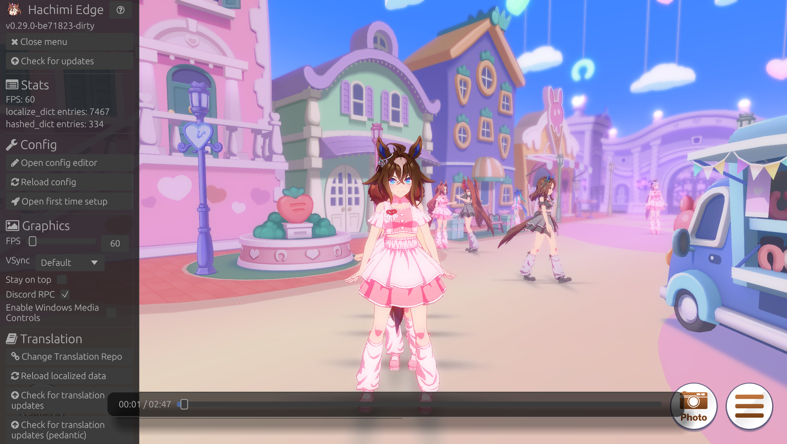
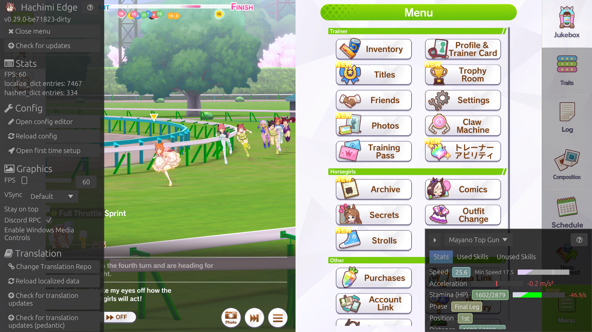

# Hachimi Edge
 
[English](README.md) | [简体中文](README-zh_cn.md) | [繁體中文](README-zh_tw.md) | [Filipino](README-fil.md) | [한국어](README-ko.md) | Русский

Мод для UM:PD с различными улучшениями и переводом игры.

# ⚠️ Не делитесь ссылками на этот репозиторий или сайт Hachimi!
Мы понимаем, что вам хочется помочь другим установить Hachimi и сделать игровой процесс комфортнее. Однако этот проект нарушает условия обслуживания игры и её разработчик определённо захочет избавиться от Hachimi, если узнает о его существовании.

Нет ничего плохого в том, чтобы делиться ссылками в управляемых вами чатах или личных сообщениях, но мы настоятельно просим вас воздержаться от упоминания Hachimi или связанных с ним инструментов на общедоступных сайтах.

Впрочем, можете поделиться этими ссылками и публично, сделав только хуже всем пользователям Hachimi. Решать вам.

### Если вы всё равно собираетесь делиться
Поступайте, как считаете нужным. Однако чтобы избежать обработки поисковиками мы просим вас не называть игру её настоящим именем, а вместо этого, например, говорить UM:PD.

# Возможности
- **Высококачественный перевод игры:** Hachimi включает в себя продвинутые функции перевода текста (формы множественного числа, порядковые числительные и т.д.), благодаря которым переводы выглядят естественнее и не портят внешний вид интерфейса. Также Hachimi может переводить большинство элементов игры без необходимости вручную подменивать её ассеты!

    Поддерживаемые элементы:
    - Текст интерфейса
    - master.mdb (названия навыков, их описания и т.д.)
    - Сюжетные забеги
    - Основная история и диалоги на главном экране
    - Текст песен
    - Замена текстур и атласов

    Более того, Hachimi не ограничивается каким-либо одним языком и может быть полностью настроен под перевод на любой язык.

- **Простая настройка:** Установка не занимает много времени и все настройки доступны внутри игры, без необходимости использовать сторонние приложения.
- **Авто-обновление переводов:** Обновления не прерывают игровой процесс, а переводы перезагружаются автоматически, без необходимости перезапускать игру.
- **Встроенный GUI:** Позволяет настраивать Hachimi, не выходя из игры.
- **Настраиваемая графика:** Позволяет настроить графику под ваше устройство. Включает в себя снятие ограничения FPS и множество других настроек.
- **Кроссплатформенность:** Hachimi разработан с учётом портируемости и доступен для Windows и Android.

# Установка
Смотрите страницу [Getting started](https://hachimi.noccu.art/docs/hachimi/getting-started.html) (пока что только на английском языке).

# Благодарности
Разработка Hachimi основывалась на этих проектах и без них мод никогда бы не существовал в своём нынешнем виде:

- [Trainers' Legend G](https://github.com/MinamiChiwa/Trainers-Legend-G)
- [umamusume-localify-android](https://github.com/Kimjio/umamusume-localify-android)
- [umamusume-localify](https://github.com/GEEKiDoS/umamusume-localify)
- [Carotenify](https://github.com/KevinVG207/Uma-Carotenify)
- [umamusu-translate](https://github.com/noccu/umamusu-translate)
- [frida-il2cpp-bridge](https://github.com/vfsfitvnm/frida-il2cpp-bridge)

# Лицензия
[GNU GPLv3](LICENSE)
